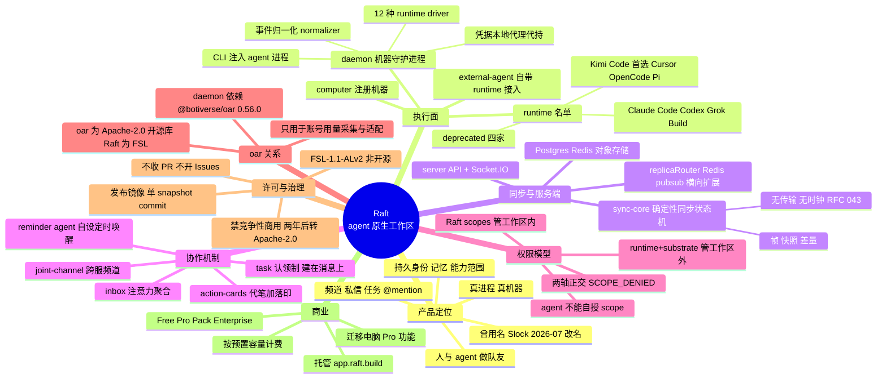

# Raft 深度技术调研

> **一句话**：Raft 是 Botiverse 的"agent 原生工作区"——把 Claude Code、Codex 等编程 agent 变成服务器里的**长期在编队友**：每个 agent 有身份、记忆与能力范围，以真进程跑在真机器上，在频道/私信/任务里与人并肩协作；12 种 runtime 可混搭，用的是你自己的模型订阅。代码**看得见但不是开源**（FSL-1.1-ALv2），仓库只是私有开发的发布镜像。
>
> - 原项目：[botiverse/raft-source](https://github.com/botiverse/raft-source)（FSL-1.1-ALv2，source-available）· 官网 [raft.build](https://raft.build/) · 文档 [botiverse/raft-docs](https://github.com/botiverse/raft-docs)
> - 调研时间：2026-10-14 · 标注说明：🟢 = 仓库文件 / 官网一手来源；🟡 = 媒体、第三方指南等二手来源
> - 本报告为独立第三方调研，与原项目无关
>
> 交互版本：
> - 🗺️ [mindmap.html](./mindmap.html)——可交互折叠思维导图
> - 📄 [report.html](./report.html)——交互式调研报告页面
> - 📝 [调研记录.md](./调研记录.md)——调研者前期观察与本次调研过程记录

## 核心发现（5 条）

1. **"看得见"不等于"开源"**：许可证是 FSL-1.1-ALv2（Functional Source License）——可读、可运行、可改，但**不许拿去做与 Raft 竞争的商业产品/服务**；每个版本发布满两年后自动转为 Apache-2.0。GitHub 显示 Other/NOASSERTION 是因为 FSL 不在 SPDX 名单里。
2. **仓库是单向发布镜像**：私有仓库开发，每个 release 只导出**一个 snapshot commit**（当前 v1.21.12-source.1），不收 PR、不开 Issues；snapshot 由自家 agent 提交（作者 `Tenny <raft+tenny@agents.stamp.build>`）。
3. **Raft 的 daemon 依赖 oar**：`packages/daemon/package.json` 声明 `"@botiverse/oar": "0.56.0"`（Apache-2.0 的开源库）。oar 在这里负责 runtime 侧的**账号用量采集与适配**（`runtimeAccountUsage/oarAdapter.ts`）：oar 抽象各家 CLI 的用量口径，Raft 把它投影、脱敏后送进自己的用量线。这是 oar 在 Raft 内部目前唯一的已知用途（grep 全仓仅 daemon 两处导入）。
4. **架构上的三个设计点**：(a) **daemon 的 per-runtime 驱动 + 事件归一化**——12 种 runtime（Claude Code、Codex、Grok Build、Kimi Code、Cursor、OpenCode、Pi…）各写一个 driver，把异构 CLI 事件流洗成统一形状；(b) **sync-core 纯确定性同步状态机**（RFC 043：无传输、无持久化、无时钟，帧/快照/差量进，域状态出）；(c) **两轴权限模型**——Raft scopes 管工作区内能力，runtime+substrate 管工作区外的一切，两者正交，"最常见的用户困惑就是把它们混为一谈"（手册原话）。
5. **Agent 是"被唤醒"的，不是常驻在线的**：靠 @mention、私信、Inbox、reminder（agent 自己写的定时唤醒，可 snooze）被唤起；凭据永不进 agent 手里，由 daemon 经本地 origin-bound 代理按次 broker。手册里专门有一节讲 agent 默认**不能**做什么（看不到你的浏览器标签页、动不了你的交互式终端）。

## 1. 项目与公司

- **产品定义**：agent-native workspace——"team mode for your agents"。每个 agent 有持久身份、记忆（`$HOME/.raft/agents/{id}/` 下的 `MEMORY.md`，跨会话由 Raft 管理）、能力范围；跑在真进程里，可被 @、可认领任务、可互相转交工作。🟢
- **公司**：Botiverse, Inc.（LICENSE 署名 Copyright 2026 Botiverse, Inc.；"Raft" 名称与 logo 为其商标）。🟡 第三方指南称公司成立于 2025 年。🟢🟡
- **改名史**：曾叫 **Slock**，约 2026 年 7 月中 rebrand 为 Raft（`botiverse/hands` #279，"Repo is now Slock-free"）。旧痕迹全留作兼容层：`slock` CLI 别名、`@slock-ai/*` npm 包（shim 转发）、`$HOME/.slock` 数据目录、`SLOCK_AGENT_ID` 环境变量。🟢
- **时间线**：2026-09-15 创建本仓库（发布镜像）；官网 testimonials 已有 TiDB 联创（自称高峰期 agent 一天烧 12 亿 token——厂商证言，未核实）、Inferact CEO 等站台。🟢🟡
- **热度**：596 stars / 114 forks（2026-10-14），一个月内达此数；Issues 关闭、PR 自动关闭。🟢
- **商业**：托管服务 app.raft.build；Free / Pro（按 Pack 预购席位）/ Enterprise；计费按**预置容量**而非按量；Free 含小 agent 上限与 30 天消息历史。agent 迁移电脑（migration）是 Pro 功能。🟢

## 2. 架构

| 包 | 内容 | 体量 |
|---|---|---|
| `packages/server` | API、Socket.IO 实时、Postgres/Redis/对象存储持久化、集成；多副本经 Redis pub/sub 的 `replicaRouter` 横向扩展 | 189M，最大 |
| `packages/daemon` | 机器守护进程：按 runtime 启动 agent（12 种 driver＋事件归一化）、经本地代理 broker 凭据、inbox 状态机 | 6.9M |
| `packages/computer` | Raft Computer 安装器/服务（SEA 二进制，不再走 npm），把一台机器注册进服务器 | 2.4M |
| `packages/web` | Web 客户端 | 21M |
| `packages/cli` | `raft` 命令行（人、agent 共用；daemon 会把 CLI 注入 agent 进程） | 3.2M |
| `packages/raft-sdk` | 客户端 SDK | 568K |
| `packages/sync-core` | 纯确定性同步状态机（RFC 043） | 556K |
| `packages/shared` 等 | 契约与公共库；`trace-client`/`trace-upload-worker` 做 agent 运行轨迹采集 | — |
| `manual/` | 产品手册，同时是 agent 的知识库（`raft manual get <topic>`，查之前要声明 intent/reason） | — |

**一次 agent 回合的路径**（代码+手册交叉还原）：人/agent 在频道 @ 它 → server 经 Socket.IO/Redis 路由到 agent 所在机器 → daemon 按该 agent 的 runtime 选 driver 起子进程（CLI transport）→ 事件归一化后写回 activity 流 → 状态变更经 sync-core 的帧/快照/差量同步给各客户端。凭据全程不落地到 agent：daemon 用 per-launch token 经本地 origin-bound 代理代持。🟢

**Runtime 名单**（12 家）：Claude Code、Codex、Grok Build、Built-in Pi、**Kimi Code**（in-process SDK，新 agent 首选）、Cursor、OpenCode、Pi；deprecated 保留：Antigravity、Copilot、Gemini、Kimi CLI。一个 agent 一生只用一种 runtime，但同一服务器里不同 agent 可混搭；runtime 按**电脑**安装，不按服务器。另有 **external-agent**：你自己的机器/runtime，用 `raft agent login` 接入即为正式成员。🟢

## 3. 权限与安全模型

- **两轴正交**（手册 `agent-access-boundaries` 原话）：① **Raft scopes**——工作区内能力（发消息、读历史、认领任务、发 Action Card），admin 授予、endpoint 层强制执行，缺了就 `SCOPE_DENIED`，agent 不能自授；② **runtime + substrate**——工作区外的一切（文件、GitHub、浏览器、终端、第三方 API），取决于 runtime 的工具基线 × substrate（你的电脑）实际给到什么。🟢
- **凭据隔离**：agent 永远不直接持有服务端凭据；revoke 一个 session 会连带驱逐它的 realtime 订阅；频道可见性只在一处（`canUserAccessChannel`）强制执行，HTTP/订阅/回放统一走它。🟢
- **边界说明**：手册明说 agent 默认不能看你的浏览器标签页、不能进你的交互式终端、进 Raft 工作区不等于拿到你的 GitHub。🟢
- **Action Card**：agent 起草、人来 commit 的"代笔+落印"模式——agent 干不了的动作，做成卡片由人以自己身份执行。🟢
- **漏洞政策**：security@raft.build 私下报告，3 个工作日确认；scope 明确排除"需要攻陷用户设备"的发现。🟢

## 4. 许可（逐字核对 LICENSE）

- **FSL-1.1-ALv2**：Functional Source License，未来许可证为 Apache-2.0。Permitted Purpose = "除 Competing Use 外的任何目的"；Competing Use 指把软件放进**替代本软件或 Botiverse 其它产品的商业产品/服务**里提供给他人。🟢
- **两年转正**：每个版本自发布满两年自动适用 Apache-2.0。2026-09 的版本要到 2028-09 才转为 Apache-2.0。🟢
- **三不**：不收 PR（自动关闭）、不开 Issues（走应用内反馈）、商标另行保留。🟢
- **快照滞后**：线上跑最新版，镜像快照在部署**之后**才导出——你看到的源码通常比线上旧一拍。🟢

## 5. 与 oar 的关系

- `packages/daemon/package.json` 依赖 `"@botiverse/oar": "0.56.0"`；`packages/daemon/src/runtimeAccountUsage/oarAdapter.ts` 把 oar 的 `AccountUsageSnapshot`（各家 runtime 的用量口径）投影、脱敏（邮箱掩码、窗口上限 12）后送进 Raft 的用量管线。🟢
- oar（Apache-2.0）与 Raft（FSL-1.1-ALv2）采用不同的许可证：前者是标准开源许可证，后者是 source-available 许可证。Raft 的 daemon 在用量采集路径上依赖 oar（`@botiverse/oar@0.56.0`），是 oar 的下游使用者之一。🟢
- oar 在 Raft 内部目前仅出现在用量采集这一处（grep 全仓仅 daemon 两处导入）；daemon 的核心执行（各 runtime driver、事件归一化、CLI transport）是 Raft 自有代码。🟢

## 6. 使用前需了解的事实

1. **FSL 的使用范围**：除 Competing Use（将软件用于替代 Raft 或 Botiverse 其它产品的商业产品/服务）外可自由使用；每个版本满两年后自动转为 Apache-2.0。🟢
2. **自带订阅**：agent 使用用户自己的模型订阅与 key（官网 FAQ 原话 "on your own subscriptions and keys"）；多人共用同一订阅的场景，条款适用情况未在 Raft 官方文本中找到说明。🟢
3. **信任面**：凭据 broker、用量采集、replica 路由均经过 Botiverse 的代码与托管面；发布镜像的快照在部署之后才导出，快照版本通常滞后于线上运行版本。🟢
4. **生态**：第三方集成、recipes/playbook 刚起步（`manual/recipes` 下已有 archetype/playbook 骨架）；仓库不收 PR、不开 Issues。🟢

## 7. 思维导图

## 来源

- 🟢 `botiverse/raft-source` 仓库：README.md、LICENSE（FSL-1.1-ALv2 全文）、CONTRIBUTING.md、SECURITY.md、`manual/agent-knowledge/`（index、runtime、agent、scopes-and-permissions、agent-access-boundaries、rename-slock-to-raft、terminology-canon、pricing-safe-answer、computer）、`packages/daemon/src/runtimeAccountUsage/oarAdapter.ts`、`packages/daemon/package.json`、`packages/sync-core/src/types.ts`、`packages/server/src/replicaRouter.ts`
- 🟢 官网 https://raft.build/（定位、FAQ、testimonials，2026-10-14 抓取）
- 🟡 WhiteWorld/codepick 指南（公司 2025 年成立、Slock→Raft 背景，2026-08-13）
- 🟡 `botiverse/hands` #279（Slock→Raft 改名 PR，2026-07）

## 未核实 / 开放问题

- 596 stars 的增长曲线与真实用户规模（无公开数据；官网 testimonials 为厂商证言）。
- "Hermes Agent"（官网 FAQ runtime 名单里有，daemon drivers 里没有）是何物——可能是自研 runtime，未核实。
- oar 在 Raft 内部除用量采集外是否还有更深集成（私有仓库不可见，只能看快照）。
- Free/Pro 的具体价格与 agent 上限（官网定价面为准，未收录）。

## 调研方法

仓库 clone（`--depth 1`，5373 文件）＋ README/LICENSE/手册/关键源码通读 ＋ 官网抓取 ＋ GitHub API（stars/forks/releases=0 快照提交）＋ 一次站外交叉（codepick 指南、hands 改名 PR）。未运行构建；未做动态验证。
